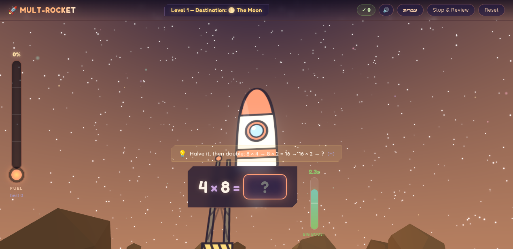
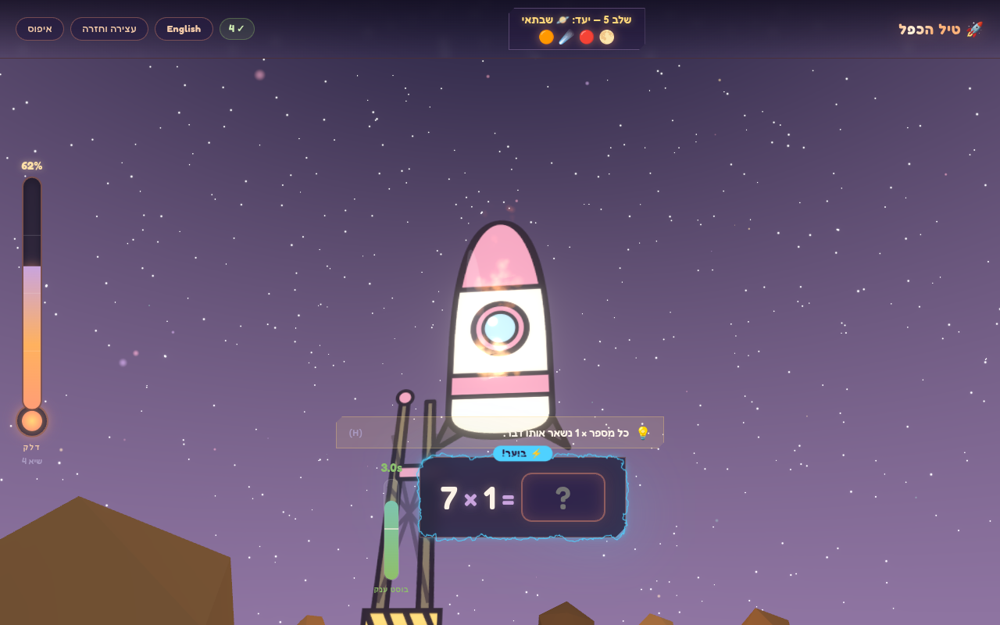
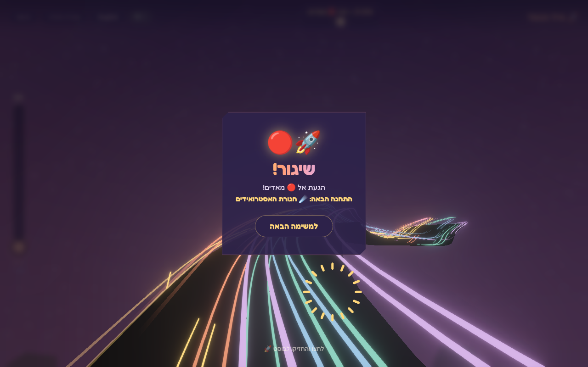
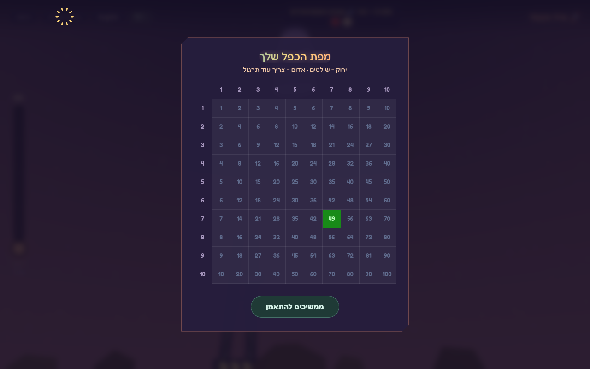
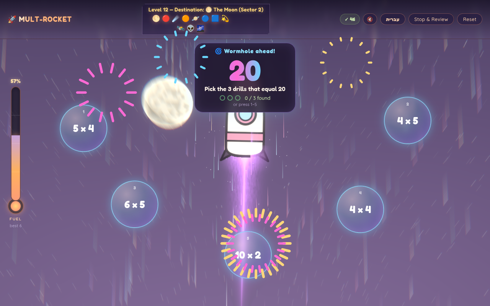
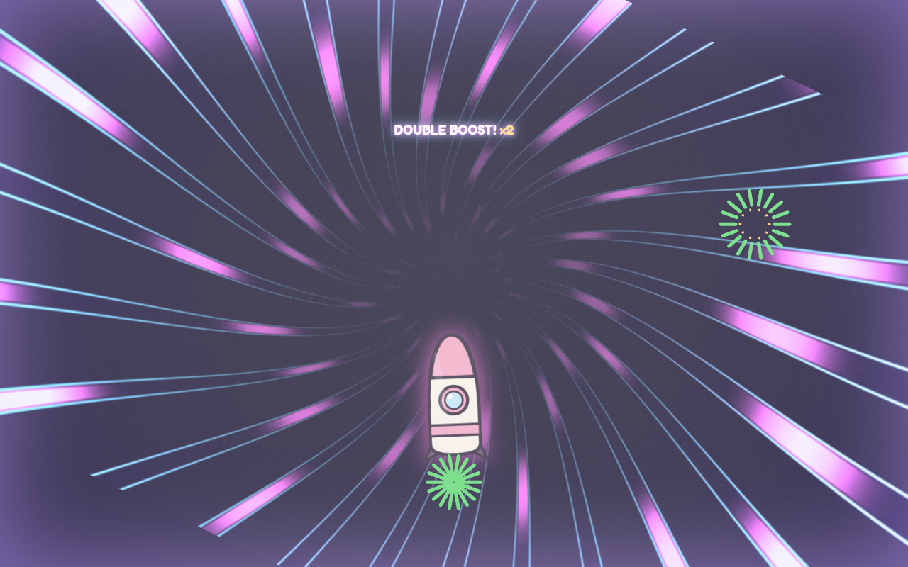
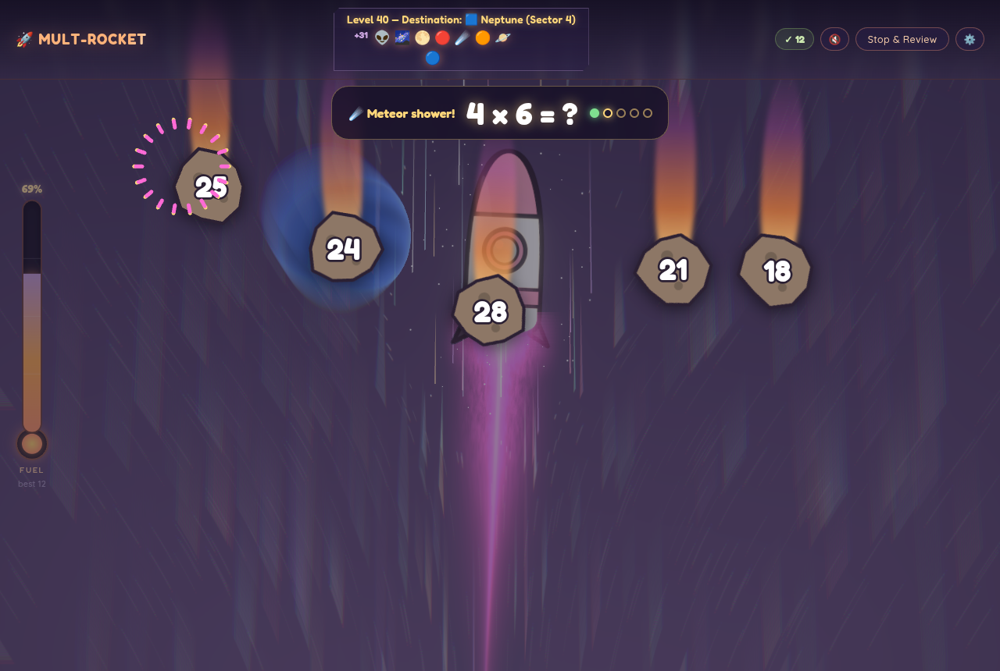
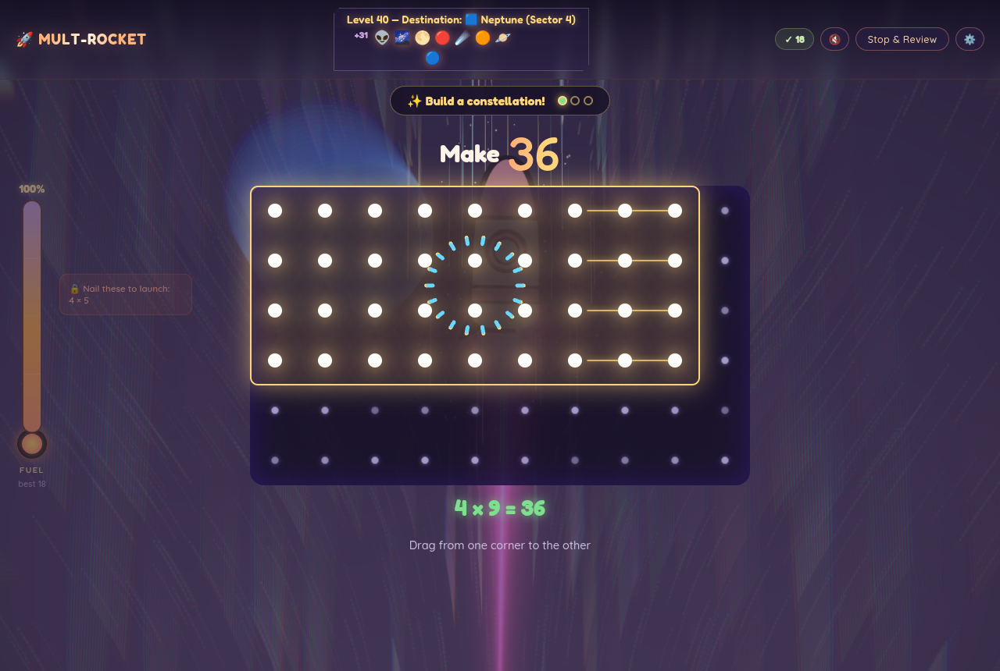
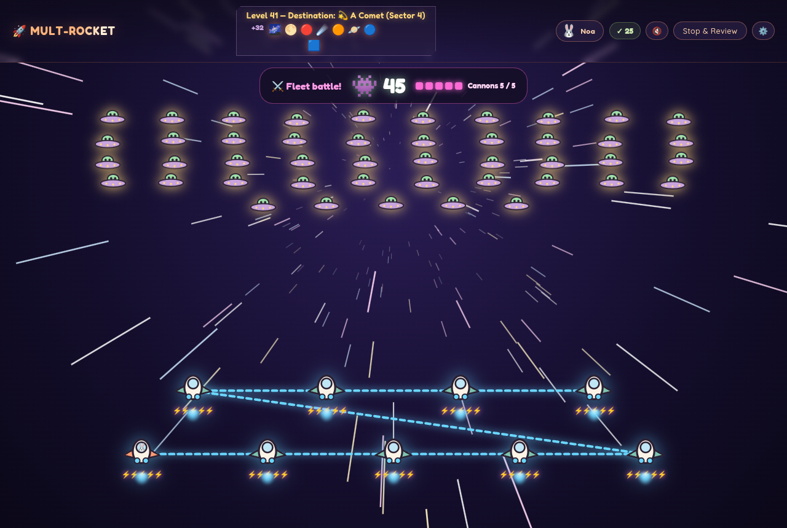
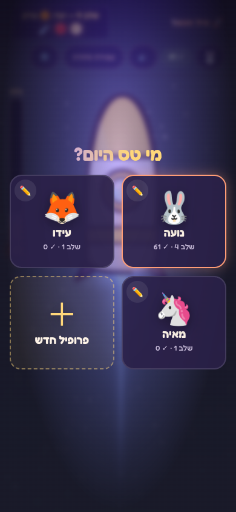

# 🚀 Multiplication Rocket

A space-rocket game for practicing the multiplication table (1–10), or addition
(**SpaceSum**: sums to 10, then 20, then 100), in **English and Hebrew**.
The rocket is always flying, under northern-lights curtains that change color every level. Every correct answer fuels it and speeds it up, and a streak of
correct answers makes it go faster still: stars stretch into streaks, the screen motion-blurs,
and the engine plume grows hotter. A wrong answer makes it brake and slow down. Fill the tank to
reach the destination planet, which grows in the sky as you get closer, and warp to the next one.



## The story 🌑

The first time the game opens, a short film tells why. It opens as films do, the date and time
and *LOCATION: NEAR EARTH ORBIT* typed in, in a terminal's glowing green, on the dark. Everything in
space runs on numbers, each with a little bloom, until the Sun turns bad. Dark veins creep across
it, its light caves in, angry eyes open and it becomes the **Black Sun**, a black hole that
swallows every number in the universe: each one splashes a crown of glyph tiles as it goes in, and
the Sun spits out what's left of them as liquid made of glowing characters, heavier where it's
thicker. The ships' engines sputter out and space traffic stops. Earth (drawn the way Kurzgesagt
draws it: flat colours, rounded lands, its night side in soft bands, its cities' lights going
out) needs a pilot, and Orbie, the ship's computer, is ready to fly with them. It's told with the game's own art, animated on a canvas, letterboxed, its words
along the bottom and read aloud (🔇 turns the voice off; *Skip* skips it). Then the launch bay
reads **EARTH NEEDS A PILOT!**, Orbie greets the new pilot by name in the hangar, and their first
take-off is a launch from Earth (the launch pad, the pilot's name and the mission typed in first):
its night side below, its edge a line of light from the top of the
screen to the bottom with a purple haze and a bloom where the Black Sun hangs over it, the ship
turning some 40° towards it, the stars stretching into hyperspace as it shrinks to a dot, and a
white-out into the **SPACE TIMES** title, which flies up into the top bar as the game begins. It
plays once per device (each new pilot gets the launch), and About has **▶ Watch the story**.
[`src/components/story/`](src/components/story/), and the plan,
[docs/plans/2026-10-27-story-intro.md](docs/plans/2026-10-27-story-intro.md).

The logo, **SPACE TIMES**, is a Gemini picture cut into layers
([`scripts/space-times-logo.py`](scripts/space-times-logo.py)): its background taken out, the
glow kept as light; the + × − ÷ tokens orbit the globe along their ring, a shine sweeps the
chrome letters, a light scans the globe, the lightning flickers, the little rockets swoop off along
their trails and the sparkles twinkle ([`SpaceTimesLogo.tsx`](src/components/logo/SpaceTimesLogo.tsx);
still with reduced motion).

## Play in your browser

**[idanbenzvi.github.io/multiplication-rocket](https://idanbenzvi.github.io/multiplication-rocket/)**. Nothing to install. Works on computers and tablets.

## Android app (in progress)

On the `androidcapacitor` branch the game is also an Android app, built with
[Capacitor](https://capacitorjs.com): the web build bundled into the app, so it plays offline.
With Java 21 and the Android SDK installed (`JAVA_HOME`, `ANDROID_HOME`), `npm run android:apk`
builds a debug APK to install on a phone or tablet. What's done and what's next is in
[docs/plans/2026-10-21-android.md](docs/plans/2026-10-21-android.md).

## Download & play (no installation needed)

Grab the file for your computer from the **[latest release](https://github.com/idanbenzvi/multiplication-rocket/releases/latest)**:

| Computer | File | How to open |
|---|---|---|
| **Windows** | `Multiplication-Rocket-…-win-x64.exe` | Double-click it. If Windows shows *"Windows protected your PC"*, click **More info → Run anyway** (the app isn't code-signed). |
| **Mac** | `Multiplication-Rocket-…-mac-universal.dmg` | Open the `.dmg` and drag the app to Applications. The first time, **right-click the app → Open → Open** (the app isn't notarized by Apple). |
| **Linux** | `Multiplication-Rocket-…-linux-x86_64.AppImage` | Right-click → Properties → allow executing as a program, then double-click. |

Progress is saved automatically on the computer.

Leaving the game (another tab or app, minimizing, locking the tablet) pauses it: music and sounds stop, the answer timer and any bonus round freeze, and a tap or key press carries on exactly where you left off.

### The cockpit (⚙️)

**⚙️** flies you into the rocket's cockpit: the camera dives in through the porthole and you're
sitting in a NASA-punk cockpit you can look all the way round. It's one 360° picture
([`public/cockpit/`](public/cockpit/), its windows cut out by
[`scripts/cockpit-360.py`](scripts/cockpit-360.py)) with the game's own screens laid on its
screens, live:

- **Straight ahead**, through the windscreen, the flight goes on: stars streaking past (as fast as
  you were flying, the HUD's speed hovering where they say), your own times tables floating by,
  and the level's destination dead ahead, as near as the fuel tank says. A HUD on the glass locks
  onto it: its name flipping in like a departures board, how far it is and how long till you're
  there (counting down), the speed, the fuel, a radar, your level, streak and right answers, and a
  telemetry log of the ship's computer checking facts.
- **The console screen** under the windscreen is the practice map.
- **The tall screen on the right wall** has the game modes; picking one blasts off to it.
- **The bank of four on the left wall**: the pilot (switch pilot, or edit yours and your ship),
  badges and rank, the sound (music and effects dials) and language, and the ship's systems (every
  setting, the parent dashboard, About, and **Reset**, which has to be held down a moment).
- **The joystick** flies back to the game, **the panel overhead** opens About, and **the remote on
  the floor** is for grown-ups (the parent dashboard).

Look round by dragging (with a mouse, resting it at an edge of the screen turns that way too, and
the wheel zooms). On a phone or a tablet the ◀ ▶ arrows turn from one screen to the next, and with
a keyboard ← → do. Touch a screen and the view rushes in to it, blurring at the edges, until it
fills the view and its page powers on; ✕ (or Escape, or a tap beside it) backs out. Now and then
the flight shudders, the lights flicker and a comet streaks past. The game is paused while you're
inside, and **Back to flight**, the joystick or Escape flies back out through the porthole. When
the rocket isn't on screen (during a bonus round or a crew flight, say), the cockpit opens out of
the ⚙️ button instead, and with reduced motion it simply fades in, and turns without sweeping.

On a computer the top bar keeps all its buttons. On a phone or a tablet it's just the pilot and
⚙️; everything else is in the cockpit.

### Canyon Run 🏜️ (in the cockpit)

**The orange buttons by the joystick** (MANUAL) take the controls: a countdown, a white-out, and
the ship dives into a canyon on the world it's flying to and races along it, at sunset, the next
destination hanging low in the sky where the sun would be. The canyon takes a little of its world's
colours (Mars redder, Neptune bluer, the alien planet greener) and its light a little of that
star's. Across the canyon,
eight times, a **gate**: a pane of light from wall to wall with **a stretch of the number line**
on it (21 numbers, every fifth named) and a fact over it, *7 × 8 = ?*, which comes up on the
windscreen too. The answer is somewhere on that line, never at its very ends: **steer to where it
is and fly through.** Near a gate the number line is painted on the floor too, a line along the
canyon for each number, your own lane lit amber, and an amber bar on the gate shows where you'll
go through.

- **← →** (or A, D) step one number; holding one glides along. On a computer the mouse steers
  too: across the screen is across the number line. On a phone or a tablet, tap a side of the
  screen for one number, hold to glide, or slide a finger across.
- Under the crosshair, **AIM** shows the number you're heading for, its digits rolling up and down
  as you steer. Every move throws you about in the seat a little: the view sways against a swerve
  and leans back as the ship speeds up.
- **Bullseye** (right on the answer): a gold flash, a whoosh, *BULLSEYE!* and a burst of speed.
  Bullseyes in a row fly faster and faster (*3 IN A ROW!*).
- **The pace follows the pilot**: every bullseye speeds the canyon up a little, and every miss
  slows it down more, between a gentle 65% and 125% of its speed, and the next run starts at the
  pace the last one ended at.
- **So close** (one or two off) and **missed it**: the windscreen shows a little number line from
  the number you flew through to the answer, the gap between them being the difference
  (*You flew through 47 · 7 × 7 = 49 · 2 further on*).
- Graze a wall and sparks fly and it slows you down; a spire knocks you aside.
- At the end the ship climbs out of the canyon and the results come up: bullseyes, close ones, the
  best run in a row, every gate with what you flew through (and the answer, if it wasn't), and
  the fuel won. **Fly again** for a new canyon (every run's is different).

The gates ask the facts the pilot finds hard, as the game does, and every gate counts towards the
practice map and the parent dashboard (a bullseye as right, anything else as wrong). Fuel is paid
for the **first run at each level** (half a right answer's for a bullseye, a fifth for a close one;
it never launches by itself, that's the game's, on the next right answer); after that, runs are
for fun. With reduced motion the canyon is flown more slowly, without the shake and the blur.

**Arriving in a canyon.** Now and then (every three or four levels, at random) reaching a
destination lands in one. The launch card says so (*🏜️ Next: a Canyon Run on Mars!*), and when
the pilot flies on, the ship dives into that world from behind, wrapped in fire as it hits the
air: a glow round its nose, tongues of flame, embers flying off, smoke streaming back (React Bits'
JetSmoke), *ENTERING ATMOSPHERE* decoding in over the world's name, the view shaking harder as it
goes deeper. Then the view rushes in, blurring, to white, and out of the white the pilot's in the
cockpit flying the canyon. At its end, **Fly on** goes back to the game. Never into the asteroid
belt, which has no ground to fly along: then it waits for the next level's end.

The canyon is made as it's flown, from noise: a height field of fractal noise with the canyon
carved along a winding path, its walls stepped in terraces of layered sandstone, gullies, dunes,
spires and far-off mesas, lit by a low sun whose soft shadows are worked out across the rock as
each stretch is built (in a worker, off the game's thread), and hazed into the sky with distance.
The design notes are in [`docs/plans/2026-10-28-canyon-run.md`](docs/plans/2026-10-28-canyon-run.md).

### Tablets and phones

The browser version is made for touch. Answers are multiple choice by default (tap one of four),
or switch **⚙️ → Ship systems → Answer by → Typing** for a big on-screen number pad. On the same
screen you can also choose when a typed answer is checked: **right away** (as soon as all its digits are
in) or **when you tap the screen** (or press ✓). On a computer, typed answers always wait for
**Enter**, so a typo can be fixed first. On Android, right answers give a revving buzz and
mistakes a thump; this can be switched off in Ship systems. iPhone and iPad browsers don't support
vibration. To make it feel like an app, use **Share → Add to Home Screen** (iPad/iPhone) or
**⋮ → Add to Home screen** (Android). It then opens full-screen with its own icon. On an iPad or
iPhone this also keeps the progress safe: Safari clears a website's saved data when it isn't opened
for 7 days, but not a Home Screen app's. The Home Screen game starts with its own, empty storage,
though, so first save a backup in the parent dashboard and restore it there (see
[Backups](#backups-)).

A phone works on its side too: the rocket flies on the left with the question beside it, and the
pilot and ⚙️ wait in the top right corner.

## How it works

- **Fuel = speed × correctness.** A correct answer adds fuel. A fast answer (green **BIG BOOST** zone) adds much more. A wrong answer empties the tank, unless it was already full.
- **The clock follows each child's own pace.** The BIG BOOST window starts at 5 seconds (and the small boost past 10) and adapts to how fast the child really answers: the median of their last five right answers, with a little headroom, so a typical answer just makes the big boost. It's quick to give more time (a few slow answers ease it off, up to 10 seconds) and slow to take it back (getting faster tightens it a little at a time, down to 2.5 seconds), and one answer left while distracted doesn't move it. It's kept for each pilot and each mission, a crew flight's pilot races their own, and the cockpit's **Speed boost** switch shows where it stands.
- **No skipping facts you still miss.** Even with a full tank, the rocket won't launch while a recently missed fact is still unresolved. The game keeps asking it until it's fixed.
- **Wrong answers teach.** A miss shows the fact as a grid (*x rows of y*) before moving on.
- **Strategy hints** (press **H**) break hard facts into easy steps, like `7 × 9 → 7 × 10 − 7`, and leave the last step to the player.
- **Mastery map.** *Stop & Review* shows a 10×10 heatmap of what's mastered (green, deeper the longer it's been remembered), what's fading (amber, with a dashed outline: time for a check) and what needs practice (red). It can also open by itself after 5 mistakes (off by default, in the cockpit's Ship systems). It's on the cockpit's console screen too. With a mouse, just hover over *Stop & Review* for a quick read-only peek at the map, with a mastered / fading / to-practice / not-tried-yet count, without pausing the game.
- **Spaced review: what's learned stays learned.** A fact is mastered when 4 of its last 5 answers are right. From then on it comes back now and then for a quick check: after a day, then 3 days, a week, 2 weeks, a month, 2 months and 4 months, each time it's remembered (a Leitner box system). A right answer before its check is due doesn't count, since practice on the same day isn't spacing. A miss starts its checks over: from the next day if it was a slip, from scratch if not. A fact left well past its check (twice its wait, and at least a week) is *fading*. It turns amber, doesn't count as mastered (for badges still to earn, the addition stages or the Black Sun's progress; ones already earned stay), and comes up often until it's answered right again. The question picker asks the facts that are due for a check as often as new ones, and fading ones more. Progress saved before spaced review was replayed from the answer history, so each fact starts in the box its past answers earned.
- **On fire 🔥.** Three in a row lights up an electric border around the question, and it gets wilder the longer the streak lasts.
- **Bonus rounds.** Every 6th question becomes a bonus round: eight kinds, shuffled, so each one comes up once before any comes again (and the order is new every time the game opens):
  - **Wormhole 🌀.** A target number and five floating drills. Pick the three that equal the target (tap them, or press 1–5) to open a wormhole, fly through it, and get a **double boost** of fuel. Two wrong picks and the wormhole closes, with no penalty. The correct drills always include at least two different factor pairs, and sometimes a swapped order (3 × 4 and 4 × 3), so it also teaches that order doesn't matter.
  - **Meteor Shower ☄️.** A drill shows at the top and numbered meteors fall across the sky. Tap the one with the answer before it burns up. A wrong tap cracks that meteor and makes the right one glow. Each hit in a row makes the next meteors fall faster. Five drills per round, each first-try hit adds fuel, and the answers count toward the mastery map.
  - **Build-a-Constellation ✨.** Make a number by dragging across a grid of stars to frame a rectangle. A live label reads "3 rows × 4 = 12", and the right size lights up as a constellation. It shows what multiplication *is* (rows times columns) and that one number can be built different ways. After two misses, a dotted outline hints at an answer.
  - **Fleet Battle ⚔️.** The view warps to forward-looking and an enemy fleet appears on the horizon, say 👾 24. Fly around (← ↑ → ↓ or drag) to collect the laser cannons, here 4. Then: "Each ship carries 4 cannons. How many ships do we need for 24 enemies?" Answer 6 and six ships fly in and circle your ship faster and faster inside a blazing ring while a power meter charges. Then one huge beam fires, flinging every enemy away in all directions, with one flying straight at you. Only the exact answer wins. Too few ships leave enemies standing ("5 ships × 4 = 20: 4 enemies left!"), and too many overload the beam ("7 ships × 4 = 28: 4 cannons too many!"). After three tries the right fleet is shown doing it. It's a first taste of division: the missing factor.
  - **Stranded Fleet 🛸.** The ship jumps to lightspeed, banking and rolling as if the pilot is fighting the controls. Stranded, out-of-fuel ships fly in one by one, each projecting a hologram drill that hides the same number: `[ ] × 4 = 28`, `[ ] × 9 = 63`, `[ ] × 2 = 14`… Spot the number they all share (7) to power them up: your ship sends an energy pulse rippling through space (a WebGL shader that bends the starfield), each ship powers up as the ring reaches it, and the whole fleet jumps to lightspeed. The sooner you guess, the bigger the fuel bonus (3× with one ship showing, down to 1× with all five). A wrong guess makes every ship check it ("6 × 4 = 24 ✗ 28"), so you can see why it doesn't fit.
  - **Stardust Run ✨.** One times table, laid out as a glowing path of stops (`7 × 4 = 28`, `7 × 5`, `7 × 6`…). Each question is the next stop, with 4 answers stacked top to bottom. A right answer and the ship glides along an arc of swirling stardust (a WebGL fluid simulation from React Bits' Splash Cursor, stirred by the ship's flight) to the next stop, which lights up and stays lit, so the chain of answers builds up behind it. Every hop is labelled `+7`: the next answer is always the last one plus the table. The wrong choices are real skip-counting slips (one stop too far, one or two off, a slipped ten), and a wrong pick gives the hint "From 28, jump 7 more." At the end the whole table is shown with the run highlighted, plus the table's pattern to remember (the 9s' digits add up to 9, the 4s end in 4, 8, 2, 6, 0…). The table comes from a fact the child finds hard, and the 3-4 jumps pass through it. On devices too slow for the fluid, it switches to a light particle trail.
  - **Acceleration Road 🛣️.** Seen from just behind the ship (your animal in the cockpit), a
    glowing rainbow road of floating slabs stretches ahead to the horizon, with holes in it. The
    engines stream sparks past the camera while the ship asks a doubling question: `1 × 2`,
    `2 × 2`, `4 × 2`, `8 × 2` (or doubles on the addition mission: `4 + 4`, `8 + 8`). Every right
    answer doubles the number, the engines' flames and spark stream, and the ship jumps the next
    hole: every hole is twice as long as the one before (1, 2, 4 and 8 slabs) and every jump twice
    as far in about the same time, so the ship really accelerates and ×2 is something you can see.
    After the fourth jump it charges, flies on to the middle of the screen, the view tilts up, and
    it blasts off skyward with a light trail, a motion-blur wake and a space-time ripple. A wrong pick gives the hint "×2 is the number twice:
    8 + 8". Only answers within the practised facts count toward the mastery map.
  - **Space Traffic 🚦.** Seen from just behind the ship, lanes of slower spaceships stretch ahead
    to the horizon: space buses, shuttles, saucers and racers, each with a number painted on its
    back, ion engines glowing and trailing sparks back past the camera, and red and green lights
    blinking on their wingtips, while stars pour out of the vanishing point on trails that fade
    behind them. Five times a slow ship pulls into your lane (target brackets lock on to it, say
    42) and a D-pad shows a drill on each side: `6 × 7`, `6 × 8`, `5 × 7`, `7 × 7`. The one that
    makes the number is the way round: tap it (or press that arrow) and the ship barrel-rolls into
    that lane and blasts past in a cartoon motion blur (speed lines, afterimages and a ring of
    stars bursting out), its engines flaring with the rocket's own plume, so every run swerves
    left, right, up and down. It's the times table read backwards (which fact makes this number?),
    and the wrong drills are near misses, one number a step off. A wrong pick brakes the ship
    behind the slow one, shows what that drill makes ("6 × 8 = 48, not 42") and lights up the
    right one. After the fifth the lane is clear and the ship races off to the vanishing point.
    Each pass made with the first pick adds fuel, and first picks count toward the mastery map.
- **Orbie, the ship's computer, helps when you're stuck.** A while without an answer (a little past the pilot's own pace, or sooner on a fact they keep missing), a glowing orb (React Bits' Orb) lights up beside the rocket, always clear of it whichever way it leans: "Stuck? Orbie can help!" Tapped, it opens a small floating window, always the same size, that thinks the question through, one way at a time, each with a picture:
  - multiplication: what it means (rows of dots), counting in jumps, the shortcut, starting from a fact the child already knows, and turning it around;
  - addition: putting them together (dots, or tens and ones), counting on, the shortcut, and starting with the bigger number.

  Every step stops one short of the answer for the child to finish, and each can be read aloud. An answer worked out with its help gets the steady boost, off the clock. Orbie can be switched off in the cockpit (**Help from Orbie**).
- **Celebrations that grow.** The praise word, spark bursts and chime all escalate with the streak (the chime climbs higher with every answer in a row). Every 5 in a row sets off fireworks and a banner.

| Hebrew + streak | Launch | Mastery map |
|---|---|---|
|  |  |  |

| Wormhole challenge | Flying through |
|---|---|
|  |  |

| Meteor Shower | Build-a-Constellation | Fleet Battle |
|---|---|---|
|  |  |  |

## Three ships: the classic rocket, the Explorer or Venus 🛸

Each pilot picks the ship they fly in the **hangar**, which opens when the game starts for a pilot
who has never chosen, just once: the choice is kept after that. To switch, ✏️ next to their name has
a **Change ship** button (a ship they haven't seen yet is marked *New!* there).

- **Classic Rocket:** the original, its nose and band in each level's colour.
- **Explorer:** a ship from a concept art. It has an egg of a hull with a navy nose and cyan light
  lines, a big glass visor with the cockpit behind it (the pilot's animal sits in the seat), vents
  and a side thruster, an open engine bay over a copper bell, and four swept landing legs tipped
  orange. It's the concept art itself, cut out of its background (`scripts/ship-cutout.py`), at
  the classic's scale:
  - the plume comes out of its bell;
  - its visor is the window to tap for the Academy;
  - the cockpit opens through it.

  In the rounds that fly behind the ship, its back is drawn to match, with one copper engine.
- **Venus:** lilac and rose gold, from a second concept art. It has mint-glowing light lines, a cream
  panel scrolled with filigree round a great round window (the pilot sits in the cockpit's seat),
  a rose-gold engine bay with its pipes and a little gear, and four legs curving out like petals,
  striped cream and mint. It's cut out the same way, its window the Explorer's size, and its back
  is drawn to match in the rounds.

A Space Admiral's Explorer or Venus has gold trim and the admiral's medal. A crew flight always takes
the classic rocket, with a window for each pilot.

## Deep Space Academy 🪐 (hidden)

**Tap the rocket's window three times quickly** to warp into the Deep Space Academy. Until a pilot has found it, their window shimmers (a pulsing halo, a glint sweeping across the glass) to invite the taps. Each tap pulls the camera closer to the ship, and the third dives through the window into the Academy. If the taps stop, the camera eases back out. The Academy is a calm
screen that teaches multiplication from the ground up, for a child who has never met "×". The
game waits while it's open. Every step can be read aloud (🔊) in English or Hebrew, so
pre-readers can follow.

The lessons follow the order the research on early multiplication supports:

1. **Equal groups.** Buses of 4 aliens; tap to count them all. Children's own starting model is
   equal groups and counting ([Mulligan & Mitchelmore, *Young children's intuitive models of
   multiplication and division*](https://researchers.mq.edu.au/en/publications/young-childrens-intuitive-models-of-multiplication-and-division-2/);
   [Mathematics Education Research Journal, 2022](https://link.springer.com/10.1007/s13394-022-00413-1)).
2. **Adding the same number:** `4 + 4 + 4`, then skip counting on a number line. Repeated
   addition is children's most common intuitive model, so it's the bridge, not the destination.
3. **The × sign** as a shortcut for "groups of": the first number is how many groups, the second
   is how many in each.
4. **Arrays.** The aliens park in rows; each row is an equal group, and the whole array is a group
   of groups ([Barmby, Harries, Higgins & Suggate 2009, *The array representation and primary
   children's understanding and reasoning in multiplication*](https://dro.dur.ac.uk/5458);
   [Outhred, PME28](https://emis.univie.ac.at/proceedings/PME28/RR/RR018_Outhred.pdf)).
5. **Turn it around.** Rotating the array shows `3 × 4 = 4 × 3`: a reasoning strategy that halves
   what has to be learned, in line with strategy-based fact fluency rather than rote drilling
   ([Baroody's phases, via NCTM/Georgia Standards](https://www.georgiastandards.org/Georgia-Standards/Documents/3rd-Math-Fluency-NCTM-2015.pdf);
   [Wisconsin DPI fact-fluency progression](https://dpi.wi.gov/sites/default/files/imce/math/files/Fact_Fluency_Infographic_-_FINAL.pdf)).
6. **Your turn**, with support that fades: build 2 groups of 3 with buttons, then read a dot
   picture, then a symbols-only problem with an optional "show me". This is the
   concrete → representational → abstract sequence
   ([meta-analytic review of CRA, University of Kentucky](https://scholars.uky.edu/en/publications/a-meta-analytic-review-of-the-concrete-representational-abstract-/)).

### On the addition mission: three courses

For an addition pilot the Academy opens on a menu of three courses, one per stage; the pilot's own
stage is marked **📍 You are here**, and finished courses get a ✓. Each follows the usual path
from counting all, to counting on, to known facts and strategies, and ends with the same fading
practice (a picture, then symbols only, with "Show me").

1. **Sums to 10:** two buses of aliens put together and counted all; the **+** sign and "sum";
   counting on from 5 along a number line; swapping `2 + 6` into `6 + 2` (start at the bigger
   number); filling a ten-frame; the pairs that make 10.
2. **Over 10:** a full ten-frame and some more (`10 + 3 = 13`, teen numbers); **make a ten
   first**: the stars of `8 + 5` fly into two ten-frames, 2 filling the first and 3 spilling into
   the next (`8 + 2 + 3 = 10 + 3`); doubles (`6 + 6`) and near doubles (`6 + 7` is one more).
3. **20 and up:** tens as rods and ones as dots (build 25 with buttons); adding tens (`30 + 20`
   counted by tens); tens with tens and ones with ones (`34 + 25`, the pieces slide together);
   **a new ten**: in `37 + 25` the 12 ones are bundled into a rod (carrying); jumping to the next
   ten (`48 + 2 + 5`).


## How does it work? 🔧 (for curious kids)

The About page (ⓘ) has a **How does the game work?** button. It opens a tour of what's going on
behind the scenes, eight short pages for 7 to 10 year olds, in English or Hebrew, each read aloud
by 🔊. It opens with the biggest secret: all of it runs on the math they're practising, since a
computer only multiplies and adds numbers, millions of times a second (even turning the rocket's
card to face you is a few multiplications and additions for each corner). Every page runs one of
the game's own pieces live, with the pilot's own ship, animal and progress, for the child to play
with:

1. **Your rocket is a sticker.** The ship is a drawing on a flat card. Walk the camera round it:
   it always faces you, because the computer keeps turning it (a billboard). Switch that off and
   it's as thin as paper; *Show the card* outlines the card.
2. **The rocket stays still. Space moves!** The game's own space dust streams past the ship at a
   speed to slide, the specks stretching into lines and the view widening.
3. **The fire is a tiny program.** The engine's plume shader at a power to slide, from icy blue to
   hot pink, a wrong answer making it sputter. *Show where it runs* outlines the rectangle it works
   out, and a counter says how many dots that is, how many times a second.
4. **The cockpit is a picture wrapped around you.** The 360° cockpit is one flat picture, an
   *equirectangular* panorama (a full turn across, from straight down to straight up, so its top
   and bottom are stretched like a world map's). A slider curls it into a ball round the camera,
   which is how the cockpit draws it; wrapped, a drag looks round, and a little map of the flat
   picture outlines the part being seen (bending as it would, wider towards the top and bottom).
   *Show the grid* draws 30° boxes, all the same size flat and squeezed towards the poles on the
   ball. Every dot's direction, how far round and how high, is where it's found in the picture,
   like longitude and latitude.
5. **The water isn't moving.** The About page's colour-cycling canyon, with three of its palette's
   ranges as strips turning beside it. The colours can be stopped, and *Show the dots that change*
   dims every pixel that never changes.
6. **The game remembers.** The spaced review's eight boxes, with a fact to answer right or wrong
   and days to let go by. The game's own rules (`game/memory.ts`) move it up, back, or keep it put,
   and it fades when it's left too long.
7. **Orbie thinks with you.** Orbie's clock runs out, its orb lights up, and its window thinks a
   question through with the same steps it would give this pilot (one starts from a fact they've
   mastered, if there is one).
8. **Sounds are made, not recorded.** An oscilloscope listens in while the four wave shapes, the
   right-answer chime (climbing with the streak) and the engine's hum play, all made by `sfx.ts`.

The game is paused while the tour is open, and its music (the About page's) plays on. It's in
[`src/components/how/`](src/components/how/), and the plan is
[`docs/plans/2026-10-22-how-it-works.md`](docs/plans/2026-10-22-how-it-works.md).

## Three missions: ×, + (SpaceSum) or both mixed

Each pilot picks a mission when they're created: **✖️ Multiplication** (the times tables, 1–10),
**➕ Addition**, or **×+ Mixed**. Each mission keeps its own journey (its
level, fuel and streaks), but what a pilot knows is theirs in all of them: a fact mastered in ×
is mastered in Mixed too, on its practice map and in its spaced review. The cockpit's Pilot screen
(⚙️) has the three side by side, each at its own level with a bar of its facts mastered; tapping
another flies off in it, back where they were (its sums as far on as the sums they already know
open). Their pilot card in the launch bay shows the other missions they've flown, and editing them
(✏️) switches too. A reset is the mission's: its journey and the facts it practises (Mixed's, all).

**Mixed** has a journey of its own: each question is × or + at random (about half each), the sums
climbing the same three addition stages as the addition mission, and each bonus round picks one of
the two for the whole round (a wormhole of drills or of sums, a meteor shower of either). Its
practice map has both grids, a tab each (and the hover peek shows both); the parent dashboard has a
third pill for it; the Deep Space Academy behind the porthole is the one for the kind of question
showing. In Crew Flight and Monster Sun a mixed pilot drills both (and can help a teammate with
either), Split Sky gives a mixed host's game either kind, and the Black Sun opens once all 115
facts (55 × and 60 +) are mastered, crowning them *Master of Universal Multiples and Sums*.

Addition climbs three stages, shown under the destination:

| Stage | Range | Example | What's being learned |
| --- | --- | --- | --- |
| 1 | sums within 10 | 3 + 4 | counting on, doubles |
| 2 | sums within 20 | 8 + 5 | crossing ten: 8 + 5 = 8 + 2 + 3 |
| 3 | numbers up to 100 | 37 + 45 | tens and ones, then carrying |

- **Moving up on success:** a launch opens the next stage once 80% of the current one is
  mastered ("New mission level! From now on: sums to 20"). One question in five keeps reviewing
  the earlier stages.
- **Stage 3** has thousands of pairs, so it tracks *kinds* of sum instead (tens + tens,
  two-digit + one-digit, two-digit + two-digit, each with and without carrying) and makes up a
  fresh problem of the kind picked. The practice map shows the 10 × 10 addition table plus a row
  for these kinds.
- **Wrong answers teach:** within 20 the sum fills ten-frames (first number, then the second in
  another colour, so making ten is visible); two-digit sums are drawn as tens rods and ones dots.
- **Hints** count on, use doubles ("6 + 7 → 6 + 6 + 1"), make ten ("8 + 5 → 8 + 2 + 3"), or add
  tens then ones ("37 + 45 → 30 + 40 + 7 + 5"), always stopping one step short.
- **Every bonus round has an addition version:**
  - **Wormhole:** pick the 3 sums that make the target (3 + 5, 6 + 2, 1 + 7 = 8).
  - **Meteor Shower:** blast the sum.
  - **Constellation:** a star chart with the first number already lit in gold; drag (or tap) to
    where the sum lands. Within 10 it's a ten-frame, within 20 two side by side (8 + 5: two fill
    the frame, three spill over), and two-digit sums use a hundred chart, where a ten is one row
    down.
  - **Fleet Battle:** the missing part. "We have 7 cannons. How many more do we need for 12
    enemies?" Each ship brings one cannon, and the power meter starts from the 7.
  - **Stranded Fleet:** every ship shows [ ] + 4 = 11, [ ] + 9 = 16, …: find the shared number.
  - **Stardust Run:** jumps of the same size along the stream (2s and 3s, crossing ten in 3s to
    6s, then +10, +20, +9 or +11), with a pattern to remember at the end ("+9 = add 10, then take
    away 1").
  - **Space Traffic:** the slow ships carry sums, and the D-pad has the sum that makes the number
    among near misses (`8 + 5` with `8 + 4`, `9 + 5`, `8 + 7`); with two-digit numbers, a ten off
    too.
- **Together:** a mixed crew works in Crew Flight: each pilot gets their own mission's questions,
  the navigator counts two groups of stars, and docking is an addition round. In Monster Sun each
  phone drills its own mission, and a missed + fact can go to any teammate, a missed × fact only
  to a × pilot. In **Split Sky**, an addition host's game has each phone count its own group of
  stars (in rows of ten), then both add the two together. Eclipse Hunters (common multiples) and
  the Academy stay multiplication only.

## Pilot profiles (siblings)

Each child can have their own pilot: a name plus an animal avatar (🐶🐱🐰🦊🐻🐼🐨🐯🦁🐮🐷🐸🐵🐧🦄🐙).
Every pilot has separate progress: level, fuel, streaks and practice map. With more than one
pilot, the game opens on **"Who's flying today?"**. Switch pilots, add a new one, or edit or delete
one from the avatar button in the top bar (or the cockpit's Pilot screen). **Reset** in the cockpit
only resets the current pilot.
Everything is stored on the device; nothing is sent anywhere. Progress from before profiles existed
is kept and becomes the first pilot.

The pilot's animal also rides in the rocket's porthole.

Answer mode, language and sound are shared by everyone on the device.



## Crew Flight 👩‍🚀👨‍🚀 (two players)

Two pilots fly **one rocket together on one device**, taking turns. The crew's rocket has two
windows, one above the other, with each pilot's animal looking out of one. Open it from **🎮 Game modes**
in the top bar or the cockpit's game-modes screen (**Fly together**, which needs 2+ pilots on the device), pick the two pilots, and
give each a seat:

- **🚀 Pilot.** The usual timed times-table drills, weighted towards that pilot's hard facts.
- **🧭 Navigator.** For a younger child: picture questions about equal groups ("3 groups of
  4 stars. How many stars?") with four big answers and a 🔊 read-aloud button. The facts start
  at factors up to 5 and widen to 6 and 7 as the navigator masters them. A miss counts the groups
  up together (4, 8, 12).

The pilot further along is suggested as Pilot, and two equals can both fly as Pilots. Every right
answer pours fuel into **one shared tank**, coloured by who added it. A navigator's answer is worth
as much as a pilot's average-speed one, so the younger child's part of the launch is just as big. A
wrong answer brakes the rocket but never drains a sibling's fuel.

Every 4th turn is **Docking 🛰️**: the station shows a number (say 24), and each child secretly
taps one number on **their own half** of the screen. The picks stay hidden (🔒) until both are in,
then `4 × 6 = 24` docks the rockets. To win, the two have to agree out loud first ("you take 4,
I'll take 6"). There are three tries, and an earlier dock is worth more fuel (3× / 2× / 1×). After
three misses, the ways to make the number are shown.

Answers count as practice for each child: they go into each pilot's own practice map and the
parent dashboard. A full tank launches the crew. Each pair of pilots has its own crew level,
separate from their solo levels. **Land** ends the flight with a summary for both, then it's back to solo
play. Design notes: [`docs/plans/2026-10-08-crew-flight.md`](docs/plans/2026-10-08-crew-flight.md).

## Split Sky 📱📱 (two phones)

Two children, two phones, **side by side**. One sky of stars spans both screens, split at the
seam where the phones touch. Each child counts their own half, then together they find the whole
sky: `6 × 8 = 6 × 3 + 6 × 5`. Breaking a hard fact into easier pieces is the same idea as the
strategy hints, but here each child holds one of the pieces.

- **Connect:** on one phone, **🎮 Game modes → 📱📱 Two phones → Host a game** shows a 4-digit code. On the other,
  **Join a game** and type it. Each phone needs one pilot. The host says which side its phone is on.
- **A round:** each phone shows only its own half (say "6 rows of 3"), and each child answers
  privately. Then both phones show both halves (`6 × 3 = 18`, `6 × 5 = 30`) and ask for the whole,
  `6 × 8`. A miss on the whole gives the hint "18 + 30". When both are done, the constellation
  lights with a glow that starts at the seam and runs out across both screens.
- When the sky is wider than 5 columns, one half is a **5** (`7 × 8 = 7 × 5 + 7 × 3`), the classic
  way to split a hard fact.
- There are 5 skies a game. Each phone records its own pilot's answers in its own practice map.
- **How it connects:** the free [PeerJS](https://peerjs.com) cloud server introduces the phones
  using the code. After that, the game goes directly phone to phone (WebRTC), and names and
  answers never touch the server. A phone that drops can rejoin with the same code and carries on
  where it left off. Both phones need the internet to connect. Some guest or mesh Wi-Fi networks
  keep phones apart; the game says so if it can't connect.

### Eclipse Hunters 🌑 (two phones)

The second two-phone game: the host picks it in the lobby, or from the summary. Each phone
has **one moon**, going round every 3 ticks on one phone and every 4 on the other.

- **Orbit:** each child skip-counts their own moon, choosing the next tick each time (3, 6, 9,
  12, 15…). The moon flies round the planet past one dot per tick. Every step is a times-table
  fact and counts as practice. The other phone's progress shows only as a count, never its numbers.
- **Predict:** "When do both moons line up for the first time?" Each child sees only their own
  list, so they have to compare out loud to find the first number in both.
- **Eclipse:** a shadow sweeps across the left phone and then the right, the planet turns into a
  glowing corona, and it's explained: `3 × 4 = 12`, and again every 12 ticks. The two periods
  never share a factor, so the first eclipse is always their product.
- 4 eclipses a game.

Design notes: [`docs/plans/2026-10-08-split-sky.md`](docs/plans/2026-10-08-split-sky.md).

## Monster Sun 👾 (2–6 phones, co-op)

A grumpy monster sun made of flickering characters and its gang are swallowing the stars, and
up to six children team up to cure them, each on their own phone.

- **Connect:** **🎮 Game modes → 👾 Monster Sun → Host a fight** shows a 4-digit code; every other phone taps
  **Join a fight** and types it. At least 2 phones are needed.
- **Fight:** every phone drills its own questions (4 choices, weighted by that pilot's mastery).
  A right answer is a blow: the monster shivers and sheds characters. A wrong one feeds it back
  one hit point, and the right answer is shown. The first monster takes **5 right answers per
  player**.
- **Don't keep it waiting:** numbers drift through space all around the monster. When nobody on
  the team answers for 5 to 8 seconds, it gets hungry: it eyes a number, the number is sucked
  in, and the monster crunches it (crumbs of digits fly, "CRUNCH!") and gets one hit point back,
  the letters it had lost growing back out of its mouth. It keeps snacking every 5 to 8 seconds
  while the team stays quiet, and can't eat past full strength.
- **Help each other:** a question you miss is sent to a random teammate as a **🆘 Help Ari!**
  card. When they solve it, you see their answer ("help from Tal: 7 × 8 = 56"), and the same
  fact comes back to you two questions later to try again.
- **Everyone sees the team:** every pilot's ship, in their colour with their animal in the
  cockpit, hovers on an arc below the monster on *every* phone, each one turned to point at it.
  Every right answer on any phone is a beam in that colour from the pilot's ship (it kicks back
  as it fires) into the monster on all the phones. The monster winces when hit,
  chomps and gloats ("YUM!") when fed, and sweats and panics when it's nearly beaten. Whoever is
  helping someone shows a 🆘 on their chip, and everyone sees "Noa helped Ari".
- **25 monsters:** the three monster suns (Glitchor, Scramblax, Hexaroth) and a gang of 22 more:
  Abracadabbit the magical rabbit, Boogloo the ghost, Tentaclex the octopus, Pentagrump the star,
  Clankatron the robot, Catastrophe the cat, Thundrix the storm cloud, Cometrix the comet,
  Ringorax the ringed planet, three-eyed Zorbluk, Jellyzap the jellyfish, Hootzilla the owl,
  Sizzlewing the dragon, Chompfin the piranha, Lunatick the moon, Pinchor the crab, Flapula the
  bat, Frostbyte the snowflake, Blazorg the flame, Swirlox the black hole, Calculord the
  calculator (made of digits) and four-eyed Gloopzilla the slime. Each is drawn in its own
  characters (the robot in 0s and 1s), and a fight's three come from a shuffled deck, so every
  one turns up once before any comes back.
- **Cured, not destroyed:** at zero its scrambled letters fly out, swirl back and unscramble
  into a friend who shows off a moment later: the sun puts on sunglasses, the flower blooms, the
  rabbit gets a top hat and waves a wand, the storm cloud makes a rainbow, the owl gets a
  graduation cap, the snowflake turns into a snowman, the moon falls asleep in a night cap, the
  calculator's eyes turn to hearts, and so on. They shine, sparkle and float hearts (or bubbles,
  music notes, Zs, stars), and the summary shows all three as the team's new friends.
- **Team combo:** right answers in a row by *anyone* build a shared combo; every 5 sends a
  shockwave through the monster.
- **Three monsters a fight**, each tougher: more hit points (6, then 7 per player), bigger tables
  (up to 6, 8, then 10) and faster flicker.
- **The summary** shows the three friends, gives every pilot an award (🤝 Super helper first, then 💥 Monster smasher,
  🎯 Sharp eye, ⭐ Brave heart) and lists the facts the team "learned together".
- A phone that drops or reloads can rejoin with the same code and keeps its seat and score.

Design notes: [`docs/plans/2026-10-10-monster-sun.md`](docs/plans/2026-10-10-monster-sun.md).

## The Black Sun 🌑 (the final boss, solo)

The finale, for a pilot who has **mastered every fact** of their mission (each one right at least
4 times out of 5: all 55 of the times table, or all 60 of the addition mission). Until then its
card in **🎮 Game modes** is locked and shows how close they are ("41 / 55"); once it opens it
stays open, the 🎮 button gets a dot and the card says *It has appeared!* (the Grand Master badge's
toast says so too).

- **Arrival:** the same as Monster Sun's: out of the warp the pilot's ship flies in at a sun in
  total eclipse, the corona flares, a diamond ring flashes and two grumpy eyes open and follow
  the ship. The rules card comes in below (beside it on a wide screen).
- **It turns into a black hole:** *Fight!* and the corona is sucked round into a swirl, a
  whirlpool of hot matter spins up round it (spiral arms winding in, brighter on the side coming
  towards you), and numbers drift in from all round, spiralling in faster and faster, stretched
  thin as they near it, until they touch the dark and are swallowed in a little star blast.
- **Cure it with 15 right in a row.** Its life bar is those 15, in three shields of five. A right
  answer flies up off its button to the ship, which fires it at the sun as a bolt of light: the
  sun winces, the dark shell cracks, and the cracks of light spread with every hit.
- **A miss before 5 in a row:** the number is pulled off its button into the hole, the sun
  laughs, its cracks seal and it gets that life back: the run starts again.
- **Checkpoints:** every 5 in a row a layer of the shell shatters off and that shield breaks for
  good. After one, a miss doesn't break the run: the sun winds up (eyes blazing, a furnace in its
  mouth) and spits a **fireball** at the ship. **Dodge it** (← or →, A or D, the big arrow buttons,
  a swipe, or a tap on either side of the ship) and the ship barrel-rolls out of the way and the
  run carries on. Get hit and the run falls back to the last checkpoint. Each fireball comes a
  little faster than the one before.
- **No skipping what you don't know:** every fact you miss comes back two questions later
  (*🔁 Again!*), so a run can't get past one you don't know. The questions lean on the pilot's
  own weakest facts and the hard middle of the table, and the last stretch only asks 3 to 9.
  On a computer the four answers sit in the arrow-key cross, as in the game.
- **The cure:** the 15th bolt shatters the shell. Everything it swallowed bursts back out, the
  ship does a victory roll and a loop and flies in close to watch, and the sun lights up gold
  from the middle out and smiles: rays grow, a rainbow arcs over it, hearts float up, and three
  dead little worlds round it bloom blue and green one by one. Then, to a fanfare and fireworks:
  **SPACE ADMIRAL LEVEL ACHIEVED! YOU ARE NOW MASTER OF UNIVERSAL MULTIPLES** (or *sums*), with the
  pilot's name and a gold medal: the cured sun under five admiral's stars, in a laurel wreath.
- **Space Admiral** is a new rank above Honored Captain, reached only this way (from any rank),
  and the medal is its insignia and a badge of its own (*Master of Universal Multiples*).
- **The admiral's livery:** from then on the admiral's rocket flies in gold and navy: a gold nose
  cone with a navy star, gold fins and window rim, gold pinstripes, a navy band of five gold stars,
  the admiral's medal under the window, and an engine plume burning gold (solo flights; a crew's
  rocket is everyone's). Their ship in the bonus rounds, Space Traffic and the Black Sun has gold
  wings and the starred band too, and in the Black Sun's finale it takes them on in a flash of gold.
- Every answer counts toward the practice map and the parent dashboard, like the other modes.
  With reduced motion the whole thing plays without the motion (the fireball still comes).

Design notes: [`docs/plans/2026-10-19-black-sun.md`](docs/plans/2026-10-19-black-sun.md).

## Parent dashboard 👪

**⚙️ → Ship systems → 📊 Parent dashboard** (or the remote on the cockpit's floor) shows how each pilot is doing over time. A
quick grown-up math question keeps kids out. Pick a pilot and a range (last 7
days, last 30 days, or all time). Each number is compared with the period just
before it.

- **Accuracy**: the share of answers that were right, per day.
- **Correct vs wrong**: daily answer counts.
- **Typical answer time**: the median time of correct answers. Falling times
  with steady accuracy mean the facts are becoming automatic.
- **Rushing**: wrong answers given in under 2 seconds, a sign of guessing
  instead of thinking.
- **Consistency**: how much daily accuracy swings from day to day.
- **Facts mastered**, the **hardest facts right now**, the facts **fading** (well past their spaced
  check, longest unchecked first), and the **most improved** facts.

Every chart has a table view. History is kept on the device only, per pilot,
and starts from v1.6. Answers from before that version weren't recorded.

### Backups 💾

Everything is saved in the browser on one device, and a browser can clear it (Safari does, for a
website that isn't opened for 7 days). So the game asks the browser to keep its storage (Chrome and
Edge decide by themselves; Firefox asks once), and the parent dashboard has a **Backup** card:

- **Save a backup** saves every pilot's progress in each mission, along with their answer history,
  badges, Black Sun record and crews, to `multiplication-rocket-backup-<date>.json`. On a phone or
  tablet it opens the share sheet (Save to Files, AirDrop, Mail); on a computer it downloads.
- **Restore from a backup** reads a backup file and lists its pilots, each with a tick box. Each
  ticked pilot replaces the same pilot on this device, or joins the pilots here. Other pilots on
  the device are left as they are. The game then reloads with them.
- On a new device, the welcome screen has a link to restore a backup before creating a pilot.
- The card also shows when the last backup was saved and whether the browser has promised to keep
  the game's storage. On an iPad or iPhone in Safari, it gives a tip about the Home Screen.

## Hebrew

The first time it opens, the game starts in Hebrew on a device that reads Hebrew (anywhere in its
list of languages) or is in Israel (its time zone, or a locale like `en-IL`), and in English
otherwise ([`src/i18n/guessLang.ts`](src/i18n/guessLang.ts)). It goes by what the device says of
itself: nothing is looked up elsewhere. When it guessed Hebrew, a little **Switch to English** note
shows at the top as it opens (on up to three openings, till it's tapped or closed with ✕).
Choose **עברית** or **English** on the cockpit's Sound screen any time; a choice is kept. The layout switches to right-to-left while equations and hint
formulas stay left-to-right, as in Israeli school workbooks. All text lives in
[`src/i18n/strings.ts`](src/i18n/strings.ts).

## Sound

The theme song, *Gliding Past the Rim*, was made for this game with Google Gemini. Monster Sun
has its own soundtrack, *The Final Lap*; a crew flight plays *The View From Higher Ground*; the
Black Sun, the final boss, plays *The View from the Last Lap*; and the
About page (ⓘ) plays *Velvet Horizon*. Each starts from the top when it opens and hands back to
whatever was playing when it closes; the cockpit plays *Starboard View*. Click 🔊 in the top bar
on a computer (or turn the dials on the cockpit's Sound screen)
for separate **music** and **sound-effect** volume (all the way down = off). The
sound effects are synthesized in the browser with Web Audio, so there are no sample files.

## Development

Requires [Node.js](https://nodejs.org) 20+.

```bash
npm install
npm run dev      # play in the browser with hot reload
npm test         # unit tests for the game logic (vitest)
npm run app      # run as a desktop app (Electron)
npm run dist     # build a desktop executable for this OS into release/
```

Built with React, TypeScript, Vite, [react-three-fiber](https://github.com/pmndrs/react-three-fiber)
for the 3D launch scene, [zustand](https://github.com/pmndrs/zustand) for state, and animated
components adapted from [React Bits](https://reactbits.dev) (Hyperspeed, LightTunnel,
Aurora, ElectricBorder, ElectricLogo, ParticleText, ClickSpark, CountUp, ShinyText, GradientText, StarBorder,
and in the cockpit Radar, SplitFlapText, Counter, DecryptedText, SpotlightCard, SquishSwitch,
HoldButton, CometDial, TargetCursor, SloshGauge) in
[`src/components/reactbits/`](src/components/reactbits/). The engine plume is React Bits'
LaserFlow shader, ported to run inside the 3D scene
([`laserFlowShader.ts`](src/components/scene/laserFlowShader.ts)). Flight speed is modeled in
[`src/game/flight.ts`](src/game/flight.ts).

### Dev mode

Add `?devmode=true` to the URL, for example `npm run dev` then http://localhost:5173/?devmode=true, or
https://idanbenzvi.github.io/multiplication-rocket/?devmode=true. A small **DEV** panel appears
in the corner. Its rows can be tapped on tablets, or use the shortcuts:

| Shortcut | Does |
|---|---|
| Shift+W | Wormhole challenge |
| Shift+M | Meteor Shower |
| Shift+C | Build-a-Constellation |
| Shift+B | Fleet Battle |
| Shift+S | Stranded Fleet |
| Shift+D | Stardust Run |
| Shift+R | Acceleration Road |
| Shift+T | Space Traffic |
| Shift+K | Fleet Battle: collect all cannons |
| Shift+G | Answer the current Stranded Fleet / Fleet Battle / Stardust Run / Acceleration Road / Space Traffic stop correctly |
| Shift+L | Complete the level (launch warp) |
| Shift+F | Fuel to 95% |
| Shift+A | Deep Space Academy |
| Shift+P | Practice map |
| Shift+U | Monster Sun gallery: all 25 monsters, and (tap *Cure them all*) the friends they turn into |
| Shift+X | The Black Sun (open even if the pilot hasn't mastered everything yet); in it, Shift+G answers right |
| Shift+J | The Black Sun: answer wrong |
| Shift+Y | The Black Sun: the run jumps to one short of the cure |

The panel's last line shows whether the Stranded Fleet energy pulse is running as a WebGL shader or has fallen back to CSS rings (with the reason), which is useful if the pulse looks wrong on a device.

Dev actions affect the current pilot's real saved progress (for example Shift+L really levels up),
so use a separate test pilot.

### Releasing a new version

Pushing a version tag builds Windows, Mac and Linux executables on GitHub Actions and attaches
them to a GitHub Release:

```bash
npm version patch        # bumps package.json, e.g. 1.0.0 -> 1.0.1, and tags v1.0.1
git push --follow-tags
```

## License

Code: [MIT](LICENSE). The app icon uses the 🚀 from [Noto Color Emoji](https://github.com/googlefonts/noto-emoji) (OFL). The About page's background is a Gemini pixel-art canyon, brought to life by colour cycling in the style of Mark Ferrari's scenes: it's an indexed image and a 256-colour palette whose ranges a WebGL shader rotates, so the lake ripples and laps at the shore, sparkles glint, stars twinkle and the rocket's porthole and engine glow ([`scripts/canyon-cycle.py`](scripts/canyon-cycle.py), [`CycleScene.tsx`](src/components/about/CycleScene.tsx)). The game studio's logo, a winged deer galloping through the air (on the About page), was made with Google Gemini; the white background was cut out of the video frame by frame, and it loops as a transparent animated WebP. The opening splash (Flying Deer Games) is two Gemini pictures of the same sky, one empty and one with the winged deer as a constellation: the deer's light is cut out of the second and appears over the first, traced by React Bits' ElectricLogo along its silhouette, with the studio's name in React Bits' ParticleText ([Unbounded](https://fonts.google.com/specimen/Unbounded), OFL).
